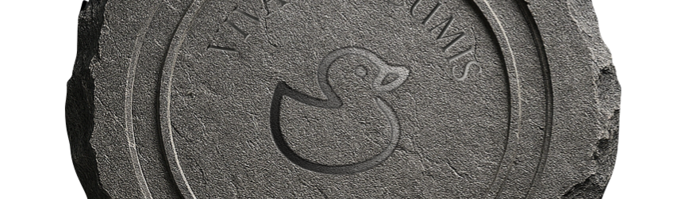
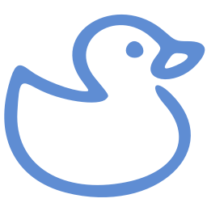

# RDCore.VSCode
<sup>_This document is available in [English](./README.md)_</sup>


<h6 align='center'>V I V A T ❤️ C U C U M I S ™</h6>
<p align='center'><small><a href='https://rubberduckvba.ca'>rubberduckvba.ca</a></small></p>
<hr/>

## Aperçu

Ce dépôt contient **RDCore pour VS Code**, l'extension qui amène le serveur de langage et l'adaptateur de débogage d'une plateforme [RDCore](https://github.com/rubberduck-vba/RDCore) dans Visual Studio Code.

L'extension est un simple client de la plateforme : elle parle les protocoles standard Language Server Protocol 3.17 et Debug Adapter Protocol à une plateforme que vous installez vous-même, et ce qu'elle affiche vient de la plateforme. Elle se situe entre l'interpréteur de commandes de RDCore (`rdc`), qui exécute du code à une invite, et l'[add-in pour HexIDE](https://github.com/rubberduck-vba/RDCore.HexIDE), qui ajoute des fonctionnalités propres à son hôte.

La plateforme elle-même, incluant le runtime RD-VBA, se trouve dans le dépôt [RDCore](https://github.com/rubberduck-vba/RDCore) et s'exécute dans des processus distincts.

[](https://github.com/rubberduck-vba/RDCore.VSCode/actions/workflows/build.yml)
[](https://github.com/rubberduck-vba/RDCore.VSCode/actions/workflows/build.yml)

### Ce que vous obtenez

Le serveur de langage dessert les modules des projets RD-VBA et VB6 : `.bas`, `.cls`, `.frm`, `.ctl`, `.pag`, `.dob`, `.doccls` et `.rdform`.

| Domaine | Ce que VS Code affiche |
|---|---|
| Édition | Complétion, aide sur la signature, survol, indicateurs incrustés, mise en forme, repli, édition liée d'un nom local |
| Navigation | Go to Definition, Declaration et Implementation, Find References, symboles du document et de l'espace de travail, hiérarchies d'appels et de types |
| Analyse | Diagnostics avec actions de code (correctifs rapides et refactorisations), lentilles de code, coloration sémantique |
| Refactorisation | Renommage selon les liaisons, et les refactorisations de la plateforme en actions de code |
| Débogage | Exécution ou débogage du programme de l'espace de travail, points d'arrêt et points d'arrêt conditionnels, pas à pas, valeurs en ligne, console de débogage |

La coloration vient des jetons sémantiques du serveur de langage : l'extension n'a pas de grammaire TextMate.

## Installation

L'extension est publiée en [préversions](https://github.com/rubberduck-vba/RDCore.VSCode/releases) **alpha**, pour évaluation.

### Prérequis

- **Une plateforme RDCore :** une version des [publications de RDCore](https://github.com/rubberduck-vba/RDCore/releases), comme la [v0.2.5-alpha](https://github.com/rubberduck-vba/RDCore/releases/tag/v0.2.5-alpha) ou une version ultérieure, ou une plateforme que vous avez compilée à partir des sources. Avec une version antérieure, VS Code peut démarrer sans la complétion, le survol, la coloration sémantique et les autres fonctionnalités du serveur. La page [Démarrer avec RDCore](https://rubberduck-vba.github.io/RDCore/getting-started.fr.html) explique comment en obtenir une.
- **L'environnement d'exécution .NET dont cette plateforme a besoin :** [.NET 11](https://dotnet.microsoft.com/download/dotnet/11.0) pour la v0.2.5-alpha.
- **Visual Studio Code** 1.146 ou une version ultérieure.

### Installer l'extension

Téléchargez le fichier `.vsix` de l'extension, `rdcore-vscode-<version>.vsix`, depuis les [publications](https://github.com/rubberduck-vba/RDCore.VSCode/releases) : par exemple `rdcore-vscode-0.1.1-alpha.vsix`. Le fichier `SHA256SUMS` qui l'accompagne permet de vérifier le téléchargement.

Ensuite, dans VS Code, lancez **Extensions: Install from VSIX...** depuis la palette de commandes et choisissez le fichier, ou exécutez :

```powershell
code --install-extension rdcore-vscode-0.1.1-alpha.vsix
```

VS Code affiche la version de l'extension sans le suffixe de la publication : `0.1.1` pour `0.1.1-alpha`. [Compiler à partir des sources](#compiler-à-partir-des-sources) explique comment produire le `.vsix` vous-même.

## Paramètres

| Paramètre | Valeur |
|---|---|
| `rdcore.platformRoot` | La racine de la plateforme : le dossier du manifeste `rdcore.json` de la plateforme. Obligatoire. |
| `rdcore.trace.server` | `off` (par défaut), `messages` ou `verbose` : trace le protocole dans le canal de sortie **RDCore**. |

La racine de la plateforme est le dossier d'une archive de publication extraite, une version installée par `rdc install` (`RDCore/Platform/versions/<version>/` dans votre dossier de données d'application locales), ou le dossier `artifacts/rdcore-dev` d'une plateforme que vous avez compilée :

```json
{
  "rdcore.platformRoot": "C:\\Dev\\RDCore\\artifacts\\rdcore-dev"
}
```

Quand le paramètre est absent, ou que le dossier n'est pas une plateforme, l'extension le dit, avec un bouton qui ouvre le paramètre. Un changement du paramètre redémarre le serveur de langage, et la commande **RDCore: Restart the Language Server** le redémarre en tout temps.

## Ouvrir un espace de travail

Ouvrez le dossier d'un projet RDCore : le dossier qui contient le fichier `.rdproj`. L'extension démarre quand le dossier ou l'un de ses sous-dossiers en contient un, ou quand vous ouvrez un module. Elle ouvre le dossier du premier `.rdproj` qu'elle trouve, dans le dossier ouvert ou jusqu'à quatre niveaux plus bas, comme espace de travail de la plateforme.

L'extension ouvre les fichiers `.bas` et `.cls` comme du VBA (`files.associations`), parce que les langages Visual Basic et TeX intégrés à VS Code les revendiquent aussi. Une autre extension peut revendiquer l'extension de fichier d'un module, et le module s'ouvre alors dans le langage de cette extension. Le serveur de langage le sert quand même, d'après son fichier, et les fonctionnalités de l'autre extension s'y appliquent aussi. Pour l'ouvrir comme du VBA, choisissez **VBA** dans l'indicateur de langage de la barre d'état, ou ajoutez l'association à vos paramètres :

```json
{
  "files.associations": { "*.bas": "vba" }
}
```

## Déboguer

Appuyez sur F5. Sans `launch.json`, l'extension exécute le programme à partir de son point d'entrée : `Main`, dans le seul module standard qui le déclare. Pour en choisir un autre, ajoutez une configuration de type `rdcore` (les extraits **RDCore: Launch**) :

```json
{
  "type": "rdcore",
  "request": "launch",
  "name": "Run the program (RDCore)",
  "module": "Program",
  "entryPoint": "Main"
}
```

| Attribut | Signification |
|---|---|
| `module` | Le module qui contient le point d'entrée. Sans lui, le seul module standard qui déclare le point d'entrée. |
| `entryPoint` | La procédure par laquelle le programme commence : `Main` par défaut. |
| `noDebug` | Exécute le programme sans le déboguer. |

Une configuration `attach` (**RDCore: Attach**) démarre la plateforme pour l'espace de travail sans exécuter de programme, et la console de débogage exécute des instructions comme à une invite.

## Compiler à partir des sources

À la racine du dépôt, avec Node.js et npm :

```powershell
npm install
npm run package
```

`npm run package` vérifie les types, regroupe l'extension et écrit `rdcore-vscode-<version>.vsix` avec `vsce package`.

- `npm run build` regroupe l'extension dans `dist/`, et `npm run watch` continue de le faire.
- F5 dans ce dépôt démarre un hôte de développement d'extension sur `samples/hello`, un petit projet pour essayer l'extension.
- `npm run smoke` démarre le serveur de langage et l'adaptateur de débogage d'une plateforme avec le code de lancement de l'extension elle-même, envoie à chacun sa requête `initialize` et affiche leurs réponses. Il vérifie la complétion et le survol dans l'exemple : un membre de sa classe, un membre de l'objet `Debug` de la bibliothèque standard, une variable et `CStr`. Il exécute ensuite le programme d'exemple jusqu'à un point d'arrêt conditionnel. Il prend `--platform-root <dossier>` (ou `RDCORE_SMOKE_PLATFORM_ROOT`) et `--workspace <dossier>`. Le flux de travail de compilation l'exécute sous Linux avec la dernière version publiée de RDCore.

### Publier

Le `.vsix` et le `SHA256SUMS` de chaque publication sont produits à partir de son étiquette `v*` par le flux de travail de publication du dépôt (`.github/workflows/release.yml`), qui atteste aussi la provenance de compilation du `.vsix` : personne ne produit une publication à la main.

Une publication se fait de l'une de deux façons. Poussez l'étiquette `v*`, et le flux de travail joint le `.vsix` et `SHA256SUMS` à une publication brouillon qu'il crée, qu'un mainteneur publie ensuite. Ou créez la publication avec ses notes dans la page **Releases** et publiez-la, ce qui crée l'étiquette, et le flux de travail les joint à cette publication, sans toucher à son titre ni à ses notes.

### Comment elle démarre la plateforme

- **Serveur de langage :** l'exécutable que le manifeste nomme `langService`, sous la racine de la plateforme, démarré dans son propre dossier avec `--pipe-name <nom> --workspace <URI du dossier> --client-process-id <pid>`, et `RDCORE_PLATFORM_ROOT` réglé à la racine de la plateforme. Le serveur écoute sur le canal nommé et l'extension s'y connecte : `\\.\pipe\<nom>` sous Windows, un socket de domaine Unix dans le dossier temporaire ailleurs.
- **Adaptateur de débogage :** le même exécutable, avec `--dap --workspace <URI du dossier>`, qui parle DAP sur son entrée et sa sortie standard.

## Voir aussi

- [Démarrer avec RDCore](https://rubberduck-vba.github.io/RDCore/getting-started.fr.html) : obtenir une plateforme, dans la documentation de RDCore
- [RDCore](https://github.com/rubberduck-vba/RDCore) : la plateforme, son _runtime_ et son serveur de langage
- [RDCore.HexIDE](https://github.com/rubberduck-vba/RDCore.HexIDE) : le module d'extension qui intègre RDCore à HexIDE
- [Billets](https://github.com/rubberduck-vba/RDCore.VSCode/issues) : pour signaler un problème
- [Code de conduite](https://github.com/rubberduck-vba/RDCore/blob/main/CODE_OF_CONDUCT.fr.md)
- [Contribuer](https://github.com/rubberduck-vba/RDCore/blob/main/CONTRIBUTING.md) : ouvert aux individus selon le [CLA de RDCore](https://github.com/rubberduck-vba/RDCore/blob/main/CLA.fr.md), une seule signature pour tous les dépôts de RDCore; les contributions corporatives sont prévues

> [!IMPORTANT]
> **Licence :** RDCore.VSCode est distribué sous la Licence publique générale GNU, version 3 ou toute version ultérieure ([LICENSE-GPLv3.md](LICENSE-GPLv3.md)). Le fichier de licence reproduit le texte officiel, en anglais. Une version française de la licence est disponible sur demande. Ce que vous construisez avec RDCore vous appartient (voir l'[AVIS de RDCore](https://github.com/rubberduck-vba/RDCore/blob/main/NOTICE.md)).

<hr/>
<p align='center'></p>
<h6 align='center'>V I V A T ❤️ C U C U M I S ™</h6>
<p align='center' style='font-size:8pt;'>
<small>© Copyright <strong>9562-7303 Québec inc.</strong> (2026)<br/><em>Seul, &quot;Rubberduck&quot; est utilisé pour fins de référence au projet open-source legacy <strong>utilisé publiquement ainsi depuis 2015</strong> et sans lien ni affiliation avec tout tiers détenteur d'une marque semblable dans quelque juridiction que ce soit.<br/>&quot;Rubberduck VBA&quot;, &quot;RDCore&quot; et &quot;VIVAT CUCUMIS&quot; sont des marques de commerce revendiquées par 9562-7303 Québec inc. (en attente); Toutes les marques appartiennent à leur détenteur respectif.<br/>RDCore.VSCode n'est pas un produit de Microsoft et n'est pas affilié à Microsoft, ni directement, ni indirectement.</em><br/><br/><em>If used alone, &quot;Rubberduck&quot; is used as a reference to the legacy open-source project <strong>the same way it has been used publicly since 2015</strong> and without any links or affiliation with any third-party trademark holders of a similar trademark in any jurisdiction.<br/>&quot;Rubberduck VBA&quot;, &quot;RDCore&quot; and &quot;VIVAT CUCUMIS&quot; are trademarks claimed by 9562-7303 Québec inc. (pending). All trademarks belong to their respective owners.<br/>RDCore.VSCode is not a Microsoft product and is not affiliated with Microsoft, directly or indirectly.</em></small>
</p>
